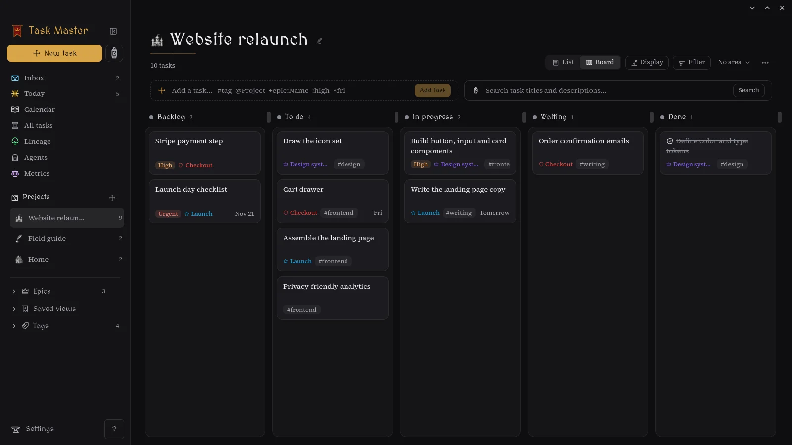
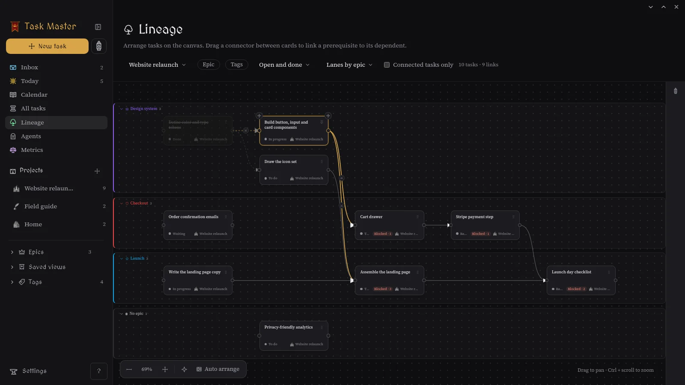
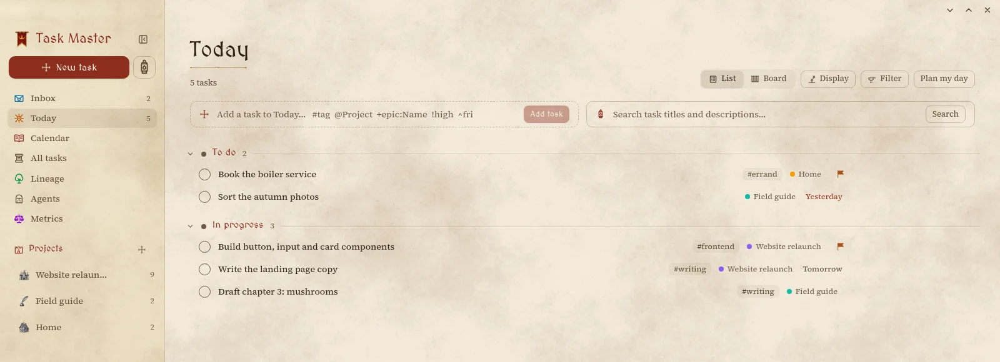

<div align="center">


**A local-first task manager for people who think in projects, chains and quests.**

Boards, lists, a dependency canvas, a calendar and Claude Code sessions, in one fast
desktop app. Your tasks live in a SQLite file on your machine; syncing is optional and
self-hosted.

[](https://github.com/AlexanderJacquot/task-master/releases/latest)
[](https://github.com/AlexanderJacquot/task-master/actions/workflows/ci.yml)
[](LICENSE)


[Download](https://github.com/AlexanderJacquot/task-master/releases/latest) ·
[Quickstart](#quickstart) ·
[Features](#features) ·
[Website](https://alexanderjacquot.github.io/task-master/)

</div>

<br>

<p align="center">
  
</p>

## Features

**Capture in one line.** Type `Fix the boiler #home @House !high ^fri +epic:Repairs` and
the tags, project, priority, due date and epic are filled in. `Ctrl+Shift+Space` opens
quick capture from any app.

**Lists and boards for every view.** Inbox, Today, All tasks, projects, epics, tags and
saved views each show as a list or a board. Board columns are your statuses, with WIP
limits. Drag, or move cards with the keyboard. Filters include "No epic" and "No tag".

**Lineage: see how work connects.** A canvas of your tasks and their prerequisites.
Draw a link by dragging from one card to another, and remove it with the × on its arrow.
Arrange cards freely, or in lanes by epic or project. Drop a card into another lane to
move it. Pin the cards you've placed so they stay put. Blocked tasks say what they're
waiting on.

<p align="center">
  
</p>

**Plan the day.** Today collects what you picked for today, plus what's overdue.
_Plan my day_ suggests the rest. The calendar holds your time blocks, and Google
Calendar sync keeps blocks, planned days and due dates in step both ways. Your other
Google calendars show alongside, read-only.

<p align="center">
  
</p>

**Send a task to Claude.** _Send to Claude_ starts a Claude Code session on a task, in
a project folder you choose. It runs in the background, reports progress through
task-master's bundled MCP server, and moves the task to _Review_ when it's done. You can
follow up, or open the session in a terminal. Works natively or through WSL on Windows.

**Everything else you'd expect.**
- Subtasks, estimates, priorities, due dates, markdown descriptions with pasted images,
  and file attachments.
- Undo and redo for every change, and a full activity history per task.
- Metrics, with a burn-down chart and figures per project and tag.
- Keyboard first: `Ctrl+K` jumps anywhere, `G` then `T` goes to Today, `?` lists every
  shortcut. Shortcuts can be remapped.
- Light and dark themes with an illuminated-manuscript style.

**Your data stays yours.**
- Everything is stored in one SQLite file on your machine, and the app works fully
  offline.
- A local backup is written daily, with optional uploads to any S3-compatible bucket.
  JSON export and import are built in.
- Optional sync between devices through a [self-hosted server](docs/server.md). It ships
  as a Docker image, edits merge automatically field by field, and attachments are
  included.
- In-app updates, signed. On Arch Linux, updates come from the AUR instead.

## Quickstart

### 1. Install

Download the installer for your system from the
[latest release](https://github.com/AlexanderJacquot/task-master/releases/latest):

| System     | File                                                                                 |
| ---------- | ------------------------------------------------------------------------------------ |
| Windows    | `…_x64-setup.exe` or `…_x64_en-US.msi`                                               |
| macOS      | `…_aarch64.dmg` (Apple silicon) or `…_x64.dmg` (Intel)                               |
| Linux      | `.AppImage` (any distribution), `.deb` (Debian, Ubuntu) or `.rpm` (Fedora, openSUSE) |
| Arch Linux | `yay -S task-master-bin` (or `paru`)                                                 |

Later versions arrive through **Settings → About and updates**, or through your package
manager on Arch.

### 2. First steps

1. Create a project with the **+** next to _Projects_ in the sidebar.
2. Add tasks with the _Add a task_ line at the top of any view, or press `Ctrl+N`. Try
   the capture syntax: `#tag`, `@Project`, `+epic:Name`, `!high`, `^tomorrow`.
3. Switch the view between **List** and **Board**, and drag cards across your statuses.
4. Open **Lineage**, pick your project, and set _Arrange_ to **Lanes by epic**. Drag
   from the dot on a card's right edge to a card that depends on it.
5. Press `?` at any time to see the keyboard shortcuts.

### 3. Optional

| To...                                     | See                                                |
| ----------------------------------------- | -------------------------------------------------- |
| Sync your devices through your own server | [docs/server.md](docs/server.md)                   |
| Show and sync Google Calendar             | [docs/google-calendar.md](docs/google-calendar.md) |
| Send tasks to Claude Code                 | [docs/agents.md](docs/agents.md)                   |
| Back up to an S3 bucket                   | [docs/backups.md](docs/backups.md)                 |

## Build from source

You need Rust (the version is pinned in `rust-toolchain.toml`; rustup installs it),
Node 24 with pnpm, and the
[Tauri prerequisites](https://tauri.app/start/prerequisites/) for your system. On
Debian or Ubuntu:

```sh
sudo apt install build-essential curl file pkg-config libssl-dev \
  libwebkit2gtk-4.1-dev libxdo-dev libayatana-appindicator3-dev librsvg2-dev
```

Then:

```sh
pnpm install
cargo build -p taskmaster-mcp   # the MCP server the dev app bundles for Claude sessions
pnpm dev                        # the desktop app, with hot reload
pnpm build                      # installers for this system
```

Before sending a change, run `cargo clippy -- -D warnings`, `cargo test`,
`pnpm biome check` and `pnpm test`. CI runs the same checks on every push.

On Forgejo, commenting `@claude` on a pull request asks Claude for a review (only the
maintainer's comments trigger it; see `.forgejo/workflows/claude.yml` and
[alex/claude-ci](https://harbor.solarnexus.space/alex/claude-ci)).

The project is built as a Rust core (`crates/core`) that owns all data and every change,
a thin Tauri shell, and a React UI. The sync server and the MCP server reuse the same
core. Read [docs/plan.md](docs/plan.md) for the design,
[docs/adr/](docs/adr/) for the decisions behind it, [progress.md](progress.md) for the
current state, and [docs/release.md](docs/release.md) for how releases are cut.

The screenshots above come from a development-only demo page that runs the real UI on
sample data: run `pnpm -C apps/desktop dev` and open
`http://localhost:1420/showcase.html#/today` (add `?theme=light` before the `#` for the
light theme).

## License

task-master is free software: you can redistribute it and/or modify it under the terms of
the [GNU Affero General Public License](LICENSE) as published by the Free Software
Foundation, either version 3 of the License, or (at your option) any later version.

It is distributed in the hope that it will be useful, but WITHOUT ANY WARRANTY; without
even the implied warranty of MERCHANTABILITY or FITNESS FOR A PARTICULAR PURPOSE. See the
GNU Affero General Public License for more details.

In short: anyone may use, change and share it, commercially too. Shared or modified
copies must stay under the same license with their source available, and that includes
a modified sync server offered to others over a network (section 13). Third-party
components keep their own licenses (MIT, Apache-2.0, BSD, ISC, MPL-2.0, OFL-1.1 and
similar, all compatible). See [ADR 020](docs/adr/020-license-agpl.md).
